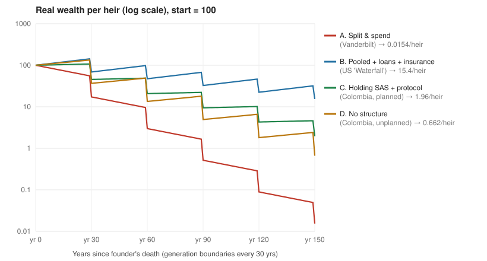

# Shirtsleeves to Shirtsleeves: Vanderbilt, Rockefeller, and Colombia

**A case study on how family fortunes survive (or don't) across generations, and what the "Rockefeller Waterfall" would look like under Colombian law.**

> 🇨🇴 Resumen en español: [RESUMEN_ES.md](RESUMEN_ES.md)

> ⚠️ **Not legal, tax, or investment advice.** This is an educational analysis. Colombian law and UVT values change every year. Talk to a Colombian *abogado de familia/sociedades* and a *contador/asesor tributario* before you structure anything.

---

## TL;DR

1. **The Vanderbilt fortune wasn't lost in a crash. The family spent it and split it.** About 96 years after the Commodore died, 120 descendants met and none of them was a millionaire (as told by family historian Arthur T. Vanderbilt II in *Fortune's Children*, 1989).
2. **The "Rockefeller Waterfall" is mostly a sales label.** The documented Rockefeller tools are the **1934 and 1952 family trusts**, a **family office**, and **philanthropy**. The idea that whole life insurance refills the pool comes from insurance marketing. I couldn't find a primary source tying it to the Rockefellers.
3. **You can't copy it word for word in Colombia.** Art. 1230(2) of the *Código de Comercio* bans fiducias whose benefit passes to **several people one after another**. The 20-year cap on fiducias is gone (repealed by Ley 1328 de 2009, art. 101). Since **Ley 1934 de 2018**, half of the estate (after debts) is *legítima* reserved for descendants or ascendants.
4. **The Colombian version keeps the assets together, not the ownership.** Put the assets in a **family holding S.A.S.** and let the shares pass to heirs, which satisfies the legítima. The company itself never splits. Add a **family protocol**, transfer restrictions in the bylaws, **loans backed by pagaré at or above the presumed-interest rate**, and **life insurance used for liquidity** to pay the 15% *ganancia ocasional*. Where useful, add a **fiducia de administración** with beneficiaries who benefit *at the same time*.
5. **The simulation says the biggest lever is spending, not structure.** A Colombian family with no structure that spends 4% a year ends up better off than Vanderbilt-style heirs with every legal tool who spend 7%. See [results](#5-simulation).

---

## 1. The source

Instagram reel by **[@lex42.co](https://www.instagram.com/reel/DdJ2GXbRzFz/)** (Sept 11, 2026, ~6.2K likes). The account makes Spanish-language legal and finance content aimed at Colombia. The caption argues:

- Cornelius Vanderbilt died the richest man in the U.S., yet by 1973 his 120 descendants had no millionaires among them.
- Rockefeller "did the opposite," and that structure is now sold in the U.S. as the *Rockefeller Waterfall*: an undivided fund, heirs who **borrow** from it under a promissory note with interest and a due date, and **life insurance on every family member** that refills the fund at each death.
- In Colombia this "as is, isn't possible" (Art. 1230 C.Co.). The 20-year limit was repealed (Ley 1328/2009), and half the estate is reserved for children (Ley 1934/2018).
- The author corrects their own use of *billonario*: in Spanish a *billón* is 10¹², so Rockefeller was the first **mil-millonario** (USD 1B, ~1916).

**What the comments show:** most comments ask *"¿Cómo se hace desde Colombia?"*, *"¿Cómo se consigue una asesoría?"*, *"¿Qué patrimonio requieres?"* The video names the problem but doesn't explain how to do it. This case study tries to fill that gap.

---

## 2. Case A: The Vanderbilts (spend, then split)

| | |
|---|---|
| Founder | Cornelius "Commodore" Vanderbilt (1794–1877), shipping and railroads |
| Fortune at death | ~USD 100M in 1877, often described as more than the U.S. Treasury held |
| Succession | ~95% left to **one son**, William Henry, who **roughly doubled it** to ~USD 200M by 1885 |
| What went wrong | Gens 3–4: Fifth Avenue mansions, Newport "cottages" (The Breakers), yachts, Biltmore. The fortune was split among many heirs at each death, with no shared governance and no reinvestment discipline |
| Outcome | 1973 reunion at Vanderbilt University: 120 descendants, no millionaires (per A.T. Vanderbilt II) |

**Lesson:** The first succession concentrated the money, and it still survived. Two things working together destroyed it:

```
annual spending  >  real return     →  the total shrinks
and division at every death         →  the shrinking total is split 3, 9, 27… ways
```

> Fact-check note: the "120 descendants, no millionaire" line is the family historian's own account. It's widely repeated, but I found no audit of tax or census records behind it. Treat it as a well-sourced anecdote, not as data.

---

## 3. Case B: The Rockefellers (pool and govern)

**What's documented:**

- **1934 trusts:** John D. Rockefeller Jr. set up trusts for his six children. A second set followed in **1952** for the grandchildren. The trusts were administered by Chase, and principal was largely kept from beneficiaries. The 1934 trusts reportedly run until the fourth generation dies out.
- **Family office ("Room 5600," Rockefeller Center):** shared investment, tax, legal, and concierge services. This is professional management, not each heir doing their own thing.
- **Philanthropy and governance:** the Rockefeller Foundation, the Rockefeller Brothers Fund, family meetings, and education of the next generation in stewardship.

**What's marketing:** The "Rockefeller Waterfall / Rockefeller Method" pages (policy loans, a whole life policy on each member, death benefits refilling the trust) are almost all from **life insurance sellers**. None of the ones I reviewed cites a primary Rockefeller document. The mechanism itself is real and legal in the U.S. through irrevocable life insurance trusts (ILITs) and dynasty trusts. The Rockefeller branding is not supported.

**How the "Waterfall" works, stripped of branding:**

```
              ┌──────────────── Undivided pool (trust) ────────────────┐
              │  invested assets  +  cash value of life policies       │
              └───────▲─────────────────┬───────────────────▲──────────┘
     loan repayments  │                 │ loans (pagaré,    │ death benefit
     with interest    │                 │ interest, due     │ at each death
                      │                 ▼ date)             │
                 ┌────┴─────────────────────────┐   ┌───────┴───────────┐
                 │ family member: business,     │   │ policy on each    │
                 │ house, education             │   │ family member     │
                 └──────────────────────────────┘   └───────────────────┘
```

**The honest economics:** life insurance is **not a return engine**. Policy returns usually sit below a diversified portfolio after costs. What insurance gives you is **liquidity exactly when it's needed**, at a death. That way the pool or the heirs never have to sell assets in a hurry to pay taxes or buy out siblings. The simulation models it that way: premiums leave the pool and earn a lower return (3.5%), then come back at each generation's death.

---

## 4. Applying it in Colombia

### 4.1 What blocks a literal copy

| Rule | What it says | Effect on the Waterfall |
|---|---|---|
| **Art. 1230 num. 2, C.Co.** | Bans fiducias "*en los cuales el beneficio se concede a diversas personas sucesivamente*" | ❌ Can't name "children, then grandchildren, then great-grandchildren" as successive beneficiaries of one fiducia |
| Art. 1230 num. 1 | Bans **secret** fiduciary arrangements | Everything has to be on the record |
| ~~Art. 1230 num. 3~~ | ~~Maximum term of 20 years~~, **repealed by Ley 1328/2009 art. 101** | ✅ A fiducia can now run longer (Superfinanciera concept 2017-063175) |
| **Ley 1934/2018** (arts. 1226, 1240, 1242 C.C.) | With legitimarios (descendants or ascendants), **50%** of the net estate is *legítima rigorosa*. The other 50% is **libre disposición**. The *cuarta de mejoras* is no longer a forced share | ⚠️ You can't lock 100% away from your children. At least half has to reach them |
| Arts. 1243–1245 C.C. (*acervo imaginario*) | Lifetime gifts get added back when legítimas are calculated | ⚠️ Moving everything into a structure before death doesn't escape the legítima. Heirs can bring an *acción de reforma del testamento* |
| **ET art. 314** (Ley 2277/2022) | Inheritances are *ganancia ocasional*, taxed at **15%**. Exempt: 3,250 UVT per heir (ET art. 307) | 💸 Each generation pays a tax the U.S. dynasty-trust version is designed to avoid |
| **ET art. 303-1** | Life insurance payouts are exempt up to **3,250 UVT** per beneficiary. The excess is taxed at 15% (the cap was 12,500 UVT before 2023; upheld in C-317/2025) | Insurance is still useful for liquidity, but much less tax-efficient than in the U.S. |
| **ET art. 35** | Loans between a company and its shareholders are *presumed* to earn at least the DTF (**9.09% for 2026**). No proof to the contrary is allowed | 📄 "Family loans" from a holding need real interest at or above that rate, or DIAN imputes it |

### 4.2 What Colombia does allow: the adapted structure

The key move is to **give the asset pool its own legal personality**. Heirs inherit **shares** in it, which satisfies the legítima, and the company itself never divides.

```
                       ┌──────────────────────────────┐
  Founder(s) ─────────▶│   FAMILY HOLDING  S.A.S.     │◀── statutes + shareholder agreement
  contribute assets    │  (Ley 1258 de 2008)          │◀── Protocolo de familia
                       │  real estate · companies ·   │
                       │  portfolio                   │
                       └──┬─────────────┬─────────────┘
         dividend policy  │             │ loans w/ pagaré, ≥ DTF (ET 35),
         (small, fixed)   │             │ collateral, repayment schedule
                          ▼             ▼
                    ┌───────────────────────────┐
                    │ Family members =          │
                    │ shareholders              │──── shares pass by will/succession
                    │ (ownership splits;        │     (legítima satisfied with shares)
                    │  assets don't)            │
                    └───────────▲───────────────┘
                                │ life insurance on parents → heirs
                                │ = cash to pay 15% GO tax and buy out
                                │   exits, with no fire sale
                       ┌────────┴──────────┐
                       │ Insurer           │
                       └───────────────────┘
   Optional: shares (or voting shares) held in a FIDUCIA MERCANTIL DE
   ADMINISTRACIÓN with CONCURRENT beneficiaries (no 20-yr cap since 2009).
```

| Waterfall element (U.S.) | Colombian equivalent | Legal hook | Caveats |
|---|---|---|---|
| Undivided dynasty trust | **Family holding S.A.S.** | Ley 1258/2008 | Corporate income tax plus dividend tax create drag. Count holding shares toward *impuesto al patrimonio* thresholds |
| Trustee controls distributions | Bylaws with **transfer restrictions** (up to 10 yrs, extendable), **prior-approval clauses**, **right of first refusal**, **exclusion clauses**; **non-voting preferred shares** to separate control from economics | Ley 1258 arts. 10–14, 24, 39 | Overly restrictive clauses may be challenged. Draft them carefully |
| Family governance | **Protocolo de familia**: family council, employment rules, dividend and loan policy, next-generation education | Supersociedades guidance; contractual | Only as strong as the family's buy-in. Review every 3–5 years |
| Heirs borrow, don't inherit | **Shareholder loans with pagaré**, collateral, schedule, interest ≥ DTF | ET art. 35; C.Co. títulos valores | Forgiven loans may be treated as dividends or gifts. Keep it real |
| Trust lasts generations | **Fiducia mercantil de administración** holding shares, **no 20-yr cap** | C.Co. 1226 ff.; Ley 1328/2009 | Beneficiaries must be **concurrent, not successive**. Where a beneficiary "class" crosses that line is a question for a lawyer |
| Insurance refills the pool | **Life insurance on the parents**, with heirs as beneficiaries, used to pay succession tax and buy out siblings who exit | ET art. 303-1 | Exempt only up to 3,250 UVT per beneficiary. If the holding is the beneficiary, ask how the corporate side is taxed |
| Avoid forced split | **Will** using the 50% libre disposición, plus a **partition by will** that assigns shares (art. 1375 C.C.) | Ley 1934/2018 | Can't impair legítimas. Lifetime gifts over 50 SMLMV need *insinuación* before a notary |

### 4.3 Who this is realistic for

These structures have fixed costs: bylaws, a protocol, a fiducia commission, annual accounting, and tax filings for the holding. As a rule of thumb, which you should check with an advisor, they make sense for families with **real estate or operating businesses worth several thousand million COP**, or anyone near the *impuesto al patrimonio* threshold. For most families, the Colombian "waterfall" is simpler:

1. Write a **will** (Ley 1934 gives you 50% to direct).
2. Buy **term life insurance** sized to cover the 15% GO tax plus succession costs.
3. Keep property in **co-ownership agreements or a small S.A.S.** instead of letting it fragment through intestate succession.
4. **Spend less than the portfolio earns.** See the next section.

---

## 5. Simulation

[`simulation/dynasty_sim.py`](simulation/dynasty_sim.py) uses only the Python standard library and has no dependencies. It tracks **real wealth per heir** over 150 years (five generations, three children per heir, 5% gross real return) under four models:

| Model | Annual leakage | Taxes at each death | Insurance |
|---|---|---|---|
| **A. Split & spend (Vanderbilt)** | 7% spending | 5% probate/frictions | — |
| **B. US "Waterfall"** | 2% net leakage + 0.75% fees | none (dynasty trust) | 1%/yr premiums @ 3.5% IRR |
| **C. Colombia, planned (holding + protocol)** | 2% dividends + 0.75% fees + 1% tax drag | 15% GO + 1% costs (insurance pays the tax) | 1%/yr premiums @ 3.5% IRR |
| **D. Colombia, unplanned** | 4% spending | 15% GO + 4% costs | — |



<!-- generated by simulation/dynasty_sim.py; see results/summary.md -->
| Model | Gen 0 | Gen 1 (yr 30) | Gen 2 (yr 60) | Gen 3 (yr 90) | Gen 4 (yr 120) | Gen 5 (yr 150) |
|---|---:|---:|---:|---:|---:|---:|
| A. Split & spend (Vanderbilt) | 100.00 | 17.27 | 2.98 | 0.52 | 0.09 | **0.02** |
| B. Pooled + loans + insurance (US) | 100.00 | 68.79 | 47.31 | 32.55 | 22.39 | **15.40** |
| C. Holding SAS + protocol (Colombia) | 100.00 | 45.54 | 20.74 | 9.44 | 4.30 | **1.96** |
| D. No structure (Colombia) | 100.00 | 36.66 | 13.44 | 4.93 | 1.81 | **0.66** |
| *Heirs alive* | 1 | 3 | 9 | 27 | 81 | 243 |

**What it shows**

1. **Spending dominates everything.** D, which has no structure at all, ends **~30× better** than A, only because it spends 4% instead of 7%. When spending is higher than the return, no legal structure can save the fortune.
2. **Pooling plus governance is worth about 3× in Colombia** (C vs D by Gen 5). Most of the gain comes from avoiding fragmentation costs and enforcing a low payout.
3. **Colombia's 15% succession tax and corporate tax drag cost about 8×** compared with a U.S. dynasty trust (B vs C). This is why insurance in Colombia is about liquidity, not tax arbitrage.
4. **Per-heir wealth falls in every model**, because the family triples each generation. A pool has to grow faster than the family tree, which at three children per heir means ~3.7% real per year *after* all leakage. Even the Rockefellers' per-heir wealth fell. What survived was the **collective** fortune and the institutions.

Fork it and change the assumptions in `MODELS` / `GLOBAL`:

```bash
python3 simulation/dynasty_sim.py
```

---

## 6. Fact-check summary

| Claim (reel) | Verdict | Notes |
|---|---|---|
| Vanderbilt was the richest American at death (1877) | ✅ Broadly accepted | ~USD 100M |
| 1973 reunion: 120 descendants, no millionaire | 🟡 Single source | A.T. Vanderbilt II, *Fortune's Children* |
| Lost to spending and splitting, not bankruptcy | ✅ | Consistent across histories |
| Rockefeller used the "Waterfall" (loans + insurance) | 🟡/❌ Unverified | Documented: 1934/1952 trusts and family office. The insurance part is marketing |
| Art. 1230 C.Co. bans successive-beneficiary fiducias | ✅ | Numeral 2, still in force |
| 20-year fiducia cap repealed by Ley 1328/2009 | ✅ | Art. 101; Superfinanciera concept 2017 |
| Ley 1934/2018: half reserved for children | ✅ (nuance) | Reserved for *legitimarios*: descendants, or ascendants if there are none |
| Rockefeller first to USD 1B (~1916) | ✅ Commonly cited | Author's *billón* correction is right |

---

## 7. Limitations

- The simulation uses constant returns and has no volatility or sequence risk. Real families also face divorce, business failure, and conflict, which are the main reasons protocols exist.
- Colombian tax figures reflect Ley 2277/2022 as of 2026. Tax reforms in Colombia are frequent.
- Offshore structures (foreign trusts or holdings) were left out. For Colombian tax residents they trigger the **ECE** regime, foreign-asset reporting, and *patrimonio* tax, and need specialized advice.

## Sources

- Reel: [@lex42.co on Instagram](https://www.instagram.com/reel/DdJ2GXbRzFz/)
- Vanderbilt: [Financial Advisor Magazine, "Shirtsleeves to shirtsleeves: the ultimate case study"](https://www.fa-mag.com/news/shirtsleeves-to-shirtsleeves--the-ultimate-case-study-23710.html) · [Grunge, "How the Vanderbilt family lost their entire fortune"](https://www.grunge.com/302542/how-the-vanderbilt-family-lost-their-entire-fortune/) · Arthur T. Vanderbilt II, *Fortune's Children* (1989)
- Rockefeller trusts: [Wikipedia, Rockefeller family](https://en.wikipedia.org/wiki/Rockefeller_family)
- Art. 1230 C.Co.: [leyes.co](https://leyes.co/codigo_de_comercio/1230.htm) · [Superfinanciera, Concepto 2017-063175](https://ambitojuridico.com/sites/default/files/BancoMedios/Archivos/cpto-63175-17.pdf) · [Superfinanciera, Contrato de fiducia mercantil](https://www.superfinanciera.gov.co/publicaciones/18604)
- Ley 1934/2018: [Rama Judicial (full text)](https://sidn.ramajudicial.gov.co/SIDN/NORMATIVA/TEXTOS_COMPLETOS/7_LEYES/LEYES%202018%20(1877-)/Ley%201934%20de%202018%20(Reforma%20el%20C%C3%B3digo%20Civil).pdf) · [Notaría 19 de Bogotá, cuarta de mejoras](https://www.notaria19bogota.com/que-es-la-cuarta-de-mejoras-y-de-libre-disposicion/)
- Ganancia ocasional and insurance: [Gerencie, indemnizaciones por seguro de vida](https://www.gerencie.com/indemnizaciones-por-seguro-de-vida-son-exentas.html) · [Siempre al Día, ganancias ocasionales](https://siemprealdia.co/colombia/impuestos/ganancias-ocasionales-en-la-declaracion-de-renta/) · [Corte Constitucional C-317/2025 (communiqué)](https://www.ambitojuridico.com/sites/default/files/2025-07/Com-Sent-C-317-25.pdf)
- Presumed interest: [Actualícese, tasa 2026](https://actualicese.com/tasa-para-liquidar-rendimientos-presuntivos-en-2026/) · [Accounter, Decreto 0898 de 2026](https://accounter.co/normatividad/decreto-0898-de-2026-interes-presunto-y-componente-inflacionario-aplicable-al-ag-2025-y-2026)
